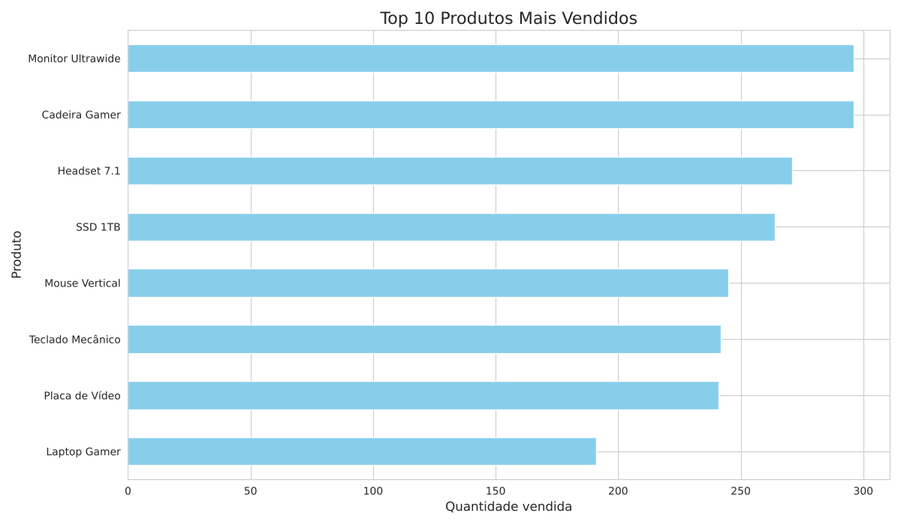
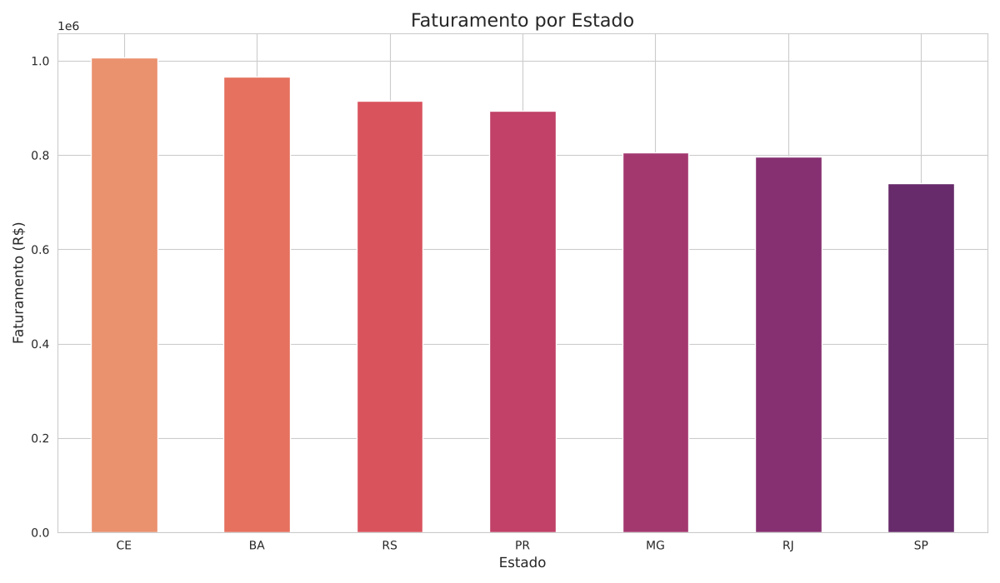

# 📊 Análise de Vendas de E-commerce com Python

[](https://colab.research.google.com/github/RodrigoVercosa118427/analise-vendas-ecommerce/blob/main/Mini_Projeto_Python_DataScience.ipynb)

Mini projeto de Data Science desenvolvido no curso **Python para Data Science** (SENAI Suíço-Brasileira). Ele transforma dados brutos de vendas em respostas para perguntas de negócio, usando **Pandas, NumPy, Matplotlib e Seaborn**.

## 🎯 Problema de negócio

Uma loja de e-commerce em crescimento tomava decisões baseadas em intuição. O projeto responde a quatro perguntas:

| Pergunta | Análise |
|---|---|
| O que vender? | Produtos mais vendidos e faturamento por categoria |
| Quando agir? | Evolução do faturamento mensal |
| Onde focar? | Faturamento por estado |
| Para onde expandir? | Estados com maior demanda |

## 🛠️ Etapas

1. **Geração dos dados**: função em Python que cria 500 pedidos fictícios (produto, categoria, preço, quantidade, cliente, cidade e estado), com semente fixa para que os resultados sejam reproduzíveis.
2. **Exploração**: `shape`, `info()`, `describe()` e tipos de dados.
3. **Limpeza e engenharia de atributos**: conversão de datas, criação das colunas `Faturamento`, `Status_Entrega` e `Mes`.
4. **Análises e gráficos**: agrupamentos com `groupby` e visualizações com Matplotlib e Seaborn.
5. **Conclusão**: insights e próximos passos.

## 📈 Resultados

| Top produtos | Faturamento mensal |
|---|---|
|  |  |

| Faturamento por estado | Faturamento por categoria |
|---|---|
|  |  |

### Principais insights

- 💰 Faturamento total de **R$ 6,13 milhões** em cerca de 3 meses.
- 🪑 **Cadeira Gamer** e **Monitor Ultrawide** lideram em unidades vendidas. A categoria **Móveis** responde por cerca de 36% do faturamento.
- 📅 O faturamento ficou estável, entre R$ 1,80 e R$ 1,88 milhão por mês (abril está incompleto).
- 🗺️ **CE** e **BA** lideram o faturamento. **SP** ficou em último, o que indica oportunidade para marketing direcionado.

> ⚠️ Os dados são **fictícios**, gerados para fins de estudo.

## 🚀 Como executar

**No Google Colab:** clique no botão *Abrir no Colab* no topo desta página. Você também pode fazer upload do notebook no Colab.

**Localmente:**

```bash
git clone https://github.com/RodrigoVercosa118427/analise-vendas-ecommerce.git
cd analise-vendas-ecommerce
pip install -r requirements.txt
jupyter notebook Mini_Projeto_Python_DataScience.ipynb
```

## 📁 Estrutura

```
├── Mini_Projeto_Python_DataScience.ipynb   # Notebook com todo o projeto
├── imagens/                                # Gráficos gerados pelo notebook
├── requirements.txt                        # Bibliotecas necessárias
└── README.md
```

## 🧰 Tecnologias

Python · Pandas · NumPy · Matplotlib · Seaborn · Jupyter / Google Colab

## 👤 Autor

**Rodrigo Verçosa**: [LinkedIn](https://www.linkedin.com/in/rodrigo-ver%C3%A7osa-5a2a71170) · [GitHub](https://github.com/RodrigoVercosa118427)
