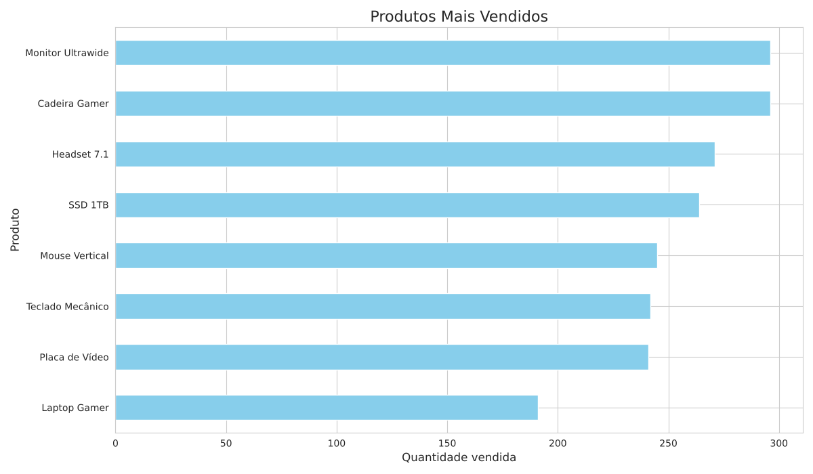
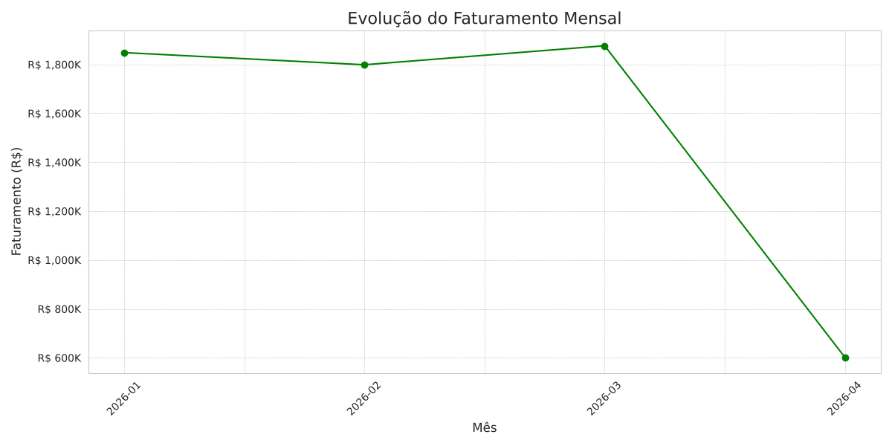
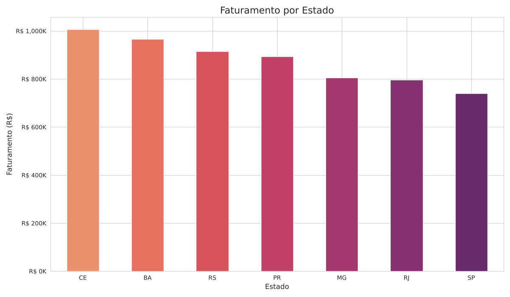
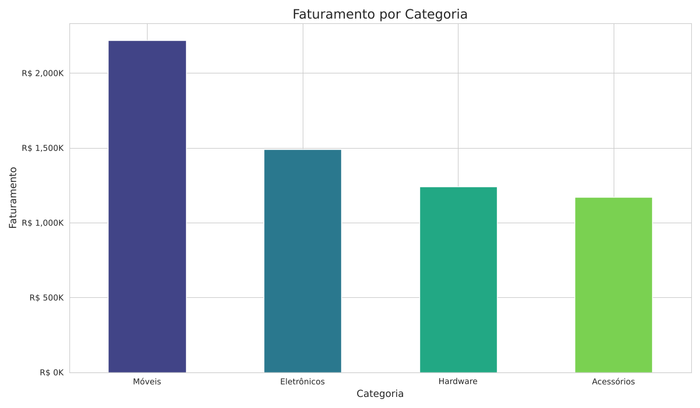

# 📊 Análise de Vendas para E-commerce

Projeto de análise de dados em Python que transforma o histórico de vendas de uma loja virtual em respostas para decisões de negócio: **o que vender, onde focar, quando agir e para onde expandir**.

➡️ **[Abrir o notebook com todos os gráficos](analise_vendas_ecommerce.ipynb)**

## O problema de negócio

A loja está crescendo, mas as decisões ainda são tomadas por intuição:

- **Estoque:** não se sabe quais produtos são os campeões de venda
- **Marketing:** as campanhas são genéricas
- **Sazonalidade:** não há visão das tendências ao longo dos meses
- **Expansão:** não há clareza sobre onde investir

## O que o projeto faz

1. **Gera os dados:** uma função cria 500 pedidos fictícios, com produto, categoria, preço, quantidade, cliente, cidade e estado
2. **Explora:** `head`, `info`, `describe` e tipos de dados
3. **Prepara:** converte datas e cria novas colunas (`Faturamento`, `Status_Entrega` com função `lambda`, `Mes`)
4. **Analisa e visualiza** quatro perguntas de negócio

## Resultados

| Produtos mais vendidos | Faturamento mensal |
|---|---|
|  |  |

| Faturamento por estado | Faturamento por categoria |
|---|---|
|  |  |

**Principais números** (500 pedidos, de 01/jan a 10/abr/2026):

- Faturamento total de **R$ 6,1 milhões** e ticket médio de **R$ 12,2 mil** por pedido
- **Móveis** lidera com 36% do faturamento, puxado pela Cadeira Gamer
- **Cadeira Gamer** e **Monitor Ultrawide** são os mais vendidos em quantidade
- **CE** e **BA** faturam mais que SP, um sinal para olhar a expansão fora do Sudeste
- A queda em abril **não é real**: o mês tem só 10 dias de dados. O notebook mostra isso numa célula de verificação.

> Os dados são fictícios e gerados com semente fixa (`seed 42`), então o resultado é sempre o mesmo.

## Tecnologias

- **Python 3**
- **Pandas:** manipulação e agregação dos dados (`groupby`, `apply`, `to_period`)
- **NumPy:** geração de valores aleatórios
- **Matplotlib** e **Seaborn:** gráficos, paletas e formatação de eixos em R$

## Como executar

```bash
pip install -r requirements.txt
jupyter notebook analise_vendas_ecommerce.ipynb
```

Ou abra direto no [Google Colab](https://colab.research.google.com/): **Arquivo > Fazer upload de notebook**.

## Autor

**Rodrigo Verçosa**: projeto desenvolvido em aula presencial do curso de Python para Data Science.
